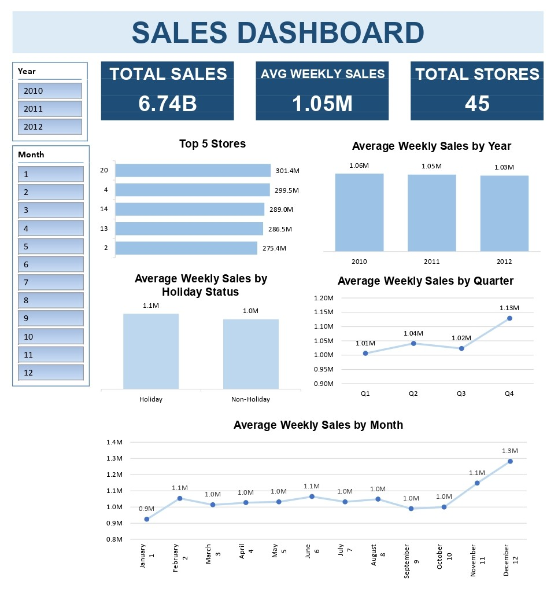

# Walmart Sales Performance Analysis

## Project Overview

This project analyzes Walmart's historical weekly sales data across 45 stores from February 2010 to October 2012 using Microsoft Excel.

The analysis focuses on evaluating sales performance, identifying seasonal trends, comparing store performance, and examining differences between holiday and non-holiday sales periods.

An interactive Excel dashboard was developed to visualize key performance indicators (KPIs) and support data-driven business decision-making.

## Project Objectives

1. **Evaluate Sales Performance** — Assess total sales and average weekly sales across 45 stores.
2. **Analyze Sales Trends & Seasonality** — Identify yearly, quarterly, monthly, and holiday-related sales patterns.
3. **Compare Store Performance** — Identify the highest-performing stores based on total sales.
4. **Develop an Interactive Dashboard** — Visualize KPIs and sales trends using Excel charts and slicers.

## Dataset Information

- **Industry:** Retail (Mass Merchandise & Grocery)
- **Source:** Walmart Store Sales Forecasting dataset (Kaggle)
- **Period:** February 2010 – October 2012
- **Records:** 6,435
- **Stores:** 45
- **Original Features:** 8

### Dataset Variables

| Variable | Data Type | Description |
|---|---|---|
| Store | Integer | Unique store identifier |
| Date | Date | Weekly reporting date |
| Weekly_Sales | Float | Weekly sales amount |
| Holiday_Flag | Integer | Holiday indicator (0 = No, 1 = Yes) |
| Temperature | Float | Regional temperature |
| Fuel_Price | Float | Regional fuel price |
| CPI | Float | Consumer Price Index |
| Unemployment | Float | Regional unemployment rate |

## Tools & Techniques

- Microsoft Excel
- Data Cleaning & Validation
- Feature Engineering
- PivotTables & PivotCharts
- Excel Formulas
- Interactive Slicers
- Data Visualization & Business Analysis

## Data Processing

### Data Cleaning & Validation

- Checked for duplicate records.
- Validated numerical and date data types.
- Verified Store IDs (1–45) and Holiday_Flag values (0 and 1).
- Confirmed that weekly sales values were positive.

### Data Transformation

- Extracted Year, Month, Quarter, and Week from reporting dates.
- Created seasonal classifications.
- Converted holiday flags into descriptive categories.
- Prepared PivotTables for sales aggregation and visualization.

## Dashboard Preview

The interactive Excel dashboard includes:

- Total Sales, Average Weekly Sales, and Total Stores KPIs
- Top 5 Stores by Total Sales
- Yearly Average Weekly Sales
- Monthly Average Weekly Sales
- Quarterly Average Weekly Sales
- Holiday vs. Non-Holiday Average Weekly Sales
- Interactive Year and Month slicers

## Key Findings

### Overall Sales Performance

- **Total Sales:** Approximately 6.74 billion
- **Average Weekly Sales:** Approximately 1.05 million
- **Total Stores:** 45

### Store Performance

- Store 20 generated the highest total sales at approximately 301.4 million.
- Stores 4, 14, 13, and 2 completed the top five.

### Seasonal Sales Trends

- December recorded the highest average weekly sales at approximately 1.28 million.
- January recorded the lowest average weekly sales at approximately 0.92 million.
- Q4 showed the highest quarterly average weekly sales at approximately 1.13 million.

### Holiday Sales Performance

- Holiday weeks recorded approximately 7.84% higher average weekly sales than non-holiday weeks.

### Yearly Sales Comparison

For a consistent February–October reporting period:

- **2010:** 1.033 million average weekly sales
- **2011:** 1.018 million average weekly sales
- **2012:** 1.046 million average weekly sales

Average weekly sales decreased by approximately 1.45% in 2011 before increasing by 2.74% in 2012.

### External Factors

Pearson correlation analysis found very weak linear relationships between weekly sales and:

- Unemployment: -0.106
- CPI: -0.073
- Temperature: -0.064
- Fuel Price: +0.009

These results do not establish causal relationships.

## Business Recommendations

1. **Optimize Year-End Planning:** Prepare inventory, staffing, and promotional campaigns for periods of stronger seasonal sales.
2. **Leverage Top-Performing Stores:** Investigate successful store practices and evaluate opportunities to apply them elsewhere.
3. **Strengthen Holiday Strategies:** Use historical holiday patterns to support promotional and inventory planning.
4. **Improve Sales Forecasting:** Incorporate historical trends, seasonality, and holiday indicators into forecasting models.

## Project Files

- [Excel Analysis & Dashboard](Walmart_Sales/Walmart_Sales.xlsx)
- [Project Presentation (PDF)](Walmart_Sales/Walmart_Sales_Presentation.pdf)
- [Dashboard Preview](Walmart_Sales/Walmart_Sales.jpg)

## Project Scope

This analysis uses historical, store-level weekly sales data. Findings describe observed patterns and associations rather than causal effects or future sales forecasts.
